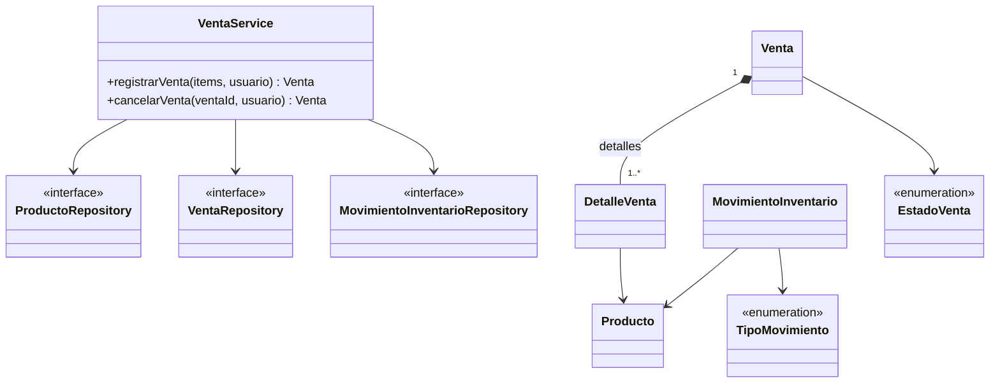

# Arquitectura

El proyecto sigue una arquitectura en capas sencilla. El servicio depende de
**interfaces** de repositorio, no de implementaciones concretas, lo que permite
probarlo con repositorios en memoria sin base de datos.

## Capas

| Paquete | Responsabilidad |
|---------|-----------------|
| `domain` | Entidades (`Producto`, `Venta`, `DetalleVenta`, `MovimientoInventario`) y enumeraciones (`EstadoVenta`, `TipoMovimiento`). Sin lógica de negocio. |
| `exception` | Excepciones de negocio, todas derivadas de `RuntimeException`. |
| `repository` | Interfaces de acceso a datos. Aún no hay implementaciones; en las pruebas se usan repositorios falsos. |
| `service` | Lógica de negocio. `VentaService` orquesta las reglas y los repositorios. |
| `testlib` | Mini framework de pruebas (`MiniTest`, `MiniRunner`) que sustituye a JUnit. |
| `test` | Pruebas unitarias de `VentaService`. |

## Diagrama de clases

## Flujos

### Registrar venta (`VentaService.registrarVenta`)

1. Rechaza la solicitud si no hay ítems (`VentaSinProductosException`).
2. Crea la venta con estado `REGISTRADA`.
3. Para cada ítem:
   1. Busca el producto (`ProductoNoEncontradoException` si no existe).
   2. Verifica que esté activo (`ProductoInactivoException`).
   3. Verifica que haya stock suficiente (`StockInsuficienteException`).
   4. Descuenta el stock, crea el detalle con el precio vigente y suma al total.
   5. Guarda un movimiento `SALIDA` con motivo "Venta".
4. Asigna el total y guarda la venta.

### Cancelar venta (`VentaService.cancelarVenta`)

1. Busca la venta (`VentaNoEncontradaException` si no existe).
2. Rechaza si ya está `CANCELADA` (`VentaYaCanceladaException`).
3. Para cada detalle devuelve las unidades al stock y guarda un movimiento
   `ENTRADA` con motivo "Cancelación de venta".
4. Cambia el estado a `CANCELADA` y guarda la venta.

## Decisiones de diseño

- **Excepciones sin marcar** (`RuntimeException`): los errores de negocio no obligan
  a declarar `throws` en cada capa.
- **`BigDecimal` para importes**: evita errores de redondeo de `double`.
- **Precio unitario copiado al detalle**: la venta conserva el precio histórico.
- **Mini framework de pruebas propio**: el proyecto no depende de librerías externas.
